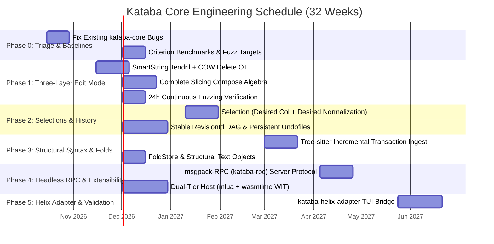

# Kataba Core: Unified Vision, Architecture, Feature Reference & Development Diary

> **"Lead with invariants, not features."**
> 
> *Kataba Core (`kataba-core`) is a pure, embeddable, mathematically verified text editing engine written in safe Rust (`#![forbid(unsafe_code)]`). It reconciles four decades of editor engineering into a deterministic, zero-I/O foundation.*

---

## Table of Contents
1. [Section 1: Executive Vision & Architectural Foundations](#section-1-executive-vision--architectural-foundations)
   - [1.1 The Four-Way Synthesis](#11-the-four-way-synthesis)
   - [1.2 The Kataba Strategic Wedge](#12-the-kataba-strategic-wedge)
   - [1.3 Explicit Scope: In-Scope vs. Out-of-Scope](#13-explicit-scope-in-scope-vs-out-of-scope)
   - [1.4 Core Mathematical Axioms (Sets A, S, H)](#14-core-mathematical-axioms-sets-a-s-h)
   - [1.5 Three-Tier Concurrency Architecture](#15-three-tier-concurrency-architecture)
   - [1.6 Three-Layer Edit Taxonomy & 9-Case Slicing Zipper](#16-three-layer-edit-taxonomy--9-case-slicing-zipper)
   - [1.7 Selections, Geometry & Desired Column](#17-selections-geometry--desired-column)
   - [1.8 History Engine: Stable Generational DAG & Undofiles](#18-history-engine-stable-generational-dag--undofiles)
   - [1.9 Multi-Buffer Coordination (Workspace Layer)](#19-multi-buffer-coordination-workspace-layer)
   - [1.10 Dual-Tier Extensibility (Canonical WIT)](#110-dual-tier-extensibility-canonical-wit)
   - [1.11 Phased Engineering Roadmap](#111-phased-engineering-roadmap)
2. [Section 2: Detailed Architectural Layers & Module Audit](#section-2-detailed-architectural-layers--module-audit)
   - [2.1 Architectural Hierarchy Diagram](#21-architectural-hierarchy-diagram)
   - [2.2 Layer 0: Primitives](#22-layer-0-primitives)
   - [2.3 Layer 1: Text Buffer (Rope)](#23-layer-1-text-buffer-rope)
   - [2.4 Layer 2: Operational Transformation (OT) Engine](#24-layer-2-operational-transformation-ot-engine)
   - [2.5 Layer 3: Selections & Grapheme Motions](#25-layer-3-selections--grapheme-motions)
   - [2.6 Layer 4: History Subsystems (DAG & Linear Stack)](#26-layer-4-history-subsystems-dag--linear-stack)
   - [2.7 Code Quality & Safety Scorecard](#27-code-quality--safety-scorecard)
3. [Section 3: Development Diary & Milestones](#section-3-development-diary--milestones)
   - [3.1 Initial Build Log & Scan Results (2026-10-12)](#31-initial-build-log--scan-results-2026-10-12)
   - [3.2 Foundational Development Decisions](#32-foundational-development-decisions)
   - [3.3 Chronological Milestones (Phases 1 to 6)](#33-chronological-milestones-phases-1-to-6)
   - [3.4 Current Test Verification Status (Unit + Integration Suites)](#34-current-test-verification-status-unit--integration-suites)
4. [Section 4: Foreign Language Interoperability & Embedding Guide](#section-4-foreign-language-interoperability--embedding-guide)
   - [4.1 Why the Core is Universally Embeddable](#41-why-the-core-is-universally-embeddable)
   - [4.2 C / C++ / Zig / Odin (C-ABI FFI via cbindgen)](#42-c--c--zig--odin-c-abi-ffi-via-cbindgen)
   - [4.3 Go / Python / Swift Integration](#43-go--python--swift-integration)
   - [4.4 WebAssembly (WASM) for TypeScript / Electron / Web](#44-webassembly-wasm-for-typescript--electron--web)
   - [4.5 Headless Process Embedding via kataba-rpc](#45-headless-process-embedding-via-kataba-rpc)
5. [Section 5: Known Edge Cases, Limitations & Prioritized Recommendations](#section-5-known-edge-cases-limitations--prioritized-recommendations)
   - [5.1 Known Limitations & Edge Cases](#51-known-limitations--edge-cases)
   - [5.2 Prioritized Action Plan](#52-prioritized-action-plan)

---

# Section 1: Executive Vision & Architectural Foundations

## 1.1 The Four-Way Synthesis

Modern text editors have historically forced developers to choose between conflicting philosophies:

- **Neovim**: High-throughput, non-blocking actor loop, embeddable headless msgpack-RPC, and persistent undofiles (`.undofile`), but crippled by 300,000 lines of legacy C, procedural mutations (`memline.c`), and an awkward single-cursor core.
- **Helix**: Selection-first multi-cursor algebra, algebraic Operational Transformation (OT), and structural Tree-sitter integration, but crippled by an inflexible walled garden (no plugin engine), ephemeral undo lost on exit, and a monolithic terminal-only binary.
- **Emacs**: Total programmability where the editor is a host, modernized via typed WebAssembly components (WASM/WIT) and Lua scripting.
- **Zed**: Unified multi-buffer editing, zero-copy B-tree ropes, and first-class AI prediction and edit preview staging.

## 1.2 The Kataba Strategic Wedge

Kataba takes **Helix's mathematical precision** and merges it with **Neovim's hackability and embeddability**, while eliminating the architectural flaws of both:

| Capability | Neovim | Helix | Kataba Core |
| :--- | :---: | :---: | :---: |
| **Cursor Model** | ❌ Single-cursor C core (Lua hack) | ✅ Multi-cursor primitive | ✅ **Multi-cursor as the ONLY primitive** |
| **Change Model** | ❌ Procedural line mutations | ✅ Algebraic OT (`ChangeSet`) | ✅ **Three-Layer OT with $O(1)$ COW deletions** |
| **Persistent Undo** | ✅ Persistent `.undofile` | ❌ Ephemeral (lost on exit) | ✅ **Persistent DAG undofiles with stable IDs** |
| **Extensibility** | ✅ In-process LuaJIT | ❌ None (monolithic) | ✅ **Dual-Tier: LuaJIT (`mlua`) + WASM (`wasmtime`)** |
| **Headless Embedding**| ✅ msgpack-RPC server | ❌ Terminal binary only | ✅ **Native msgpack-RPC protocol (`kataba-rpc`)** |
| **AI Foundations** | ❌ Plugin virtual text hacks | ❌ None | ✅ **Core streaming prediction & preview hooks** |
| **Language & Safety** | ❌ 300k lines of C99 | ✅ 25k lines of Rust | ✅ **Pure, audited, `#![forbid(unsafe_code)]` Rust** |

## 1.3 Explicit Scope: In-Scope vs. Out-of-Scope

`kataba-core` is **not** an editor binary. It does not draw pixels or render terminal cells. It is the **pure engine** crate.

### In-Scope (What `kataba-core` Owns)
1. **Text Representation (`TextBuffer`):** Wraps `ropey::Rope` as a copy-on-write B-tree with zero-copy grapheme cluster streaming and multi-coordinate translations (Char, Byte, Grapheme, UTF-16, Display).
2. **Operational Transformation (`ChangeSet` & `Transaction`):** Three-layer edit pipeline with a complete 9-case slicing compose algebra and pure, document-independent inversion.
3. **Strict Multi-Cursor Selections (`Selection` & `Range`):** Every motion is selection-first. Disjoint, sorted normalization with primary cursor preservation and active-head visual column memory (`desired_col`).
4. **Persistent State Journal (`History`):** Acyclic revision DAG with stable generational `RevisionId(u64)`s, bounded LRU byte-budget eviction, and binary `.undofile` serialization.
5. **Structural Syntax (`LayerStack`):** Consumes sequential atomic `Transaction`s to derive 6-field `tree_sitter::InputEdit`s, evaluating pure data-driven `TextObjectQuery`s.
6. **Editing Primitives as Data:** `RegisterStore` (yank/named/numbered), `MacroRecorder` (replaying deterministic command streams), and active `SnippetSession` tabstops.

### Out-of-Scope (Strict Non-Goals for `kataba-core`)
- 🚫 **No UI, Rendering, or ANSI Escapes:** Belongs strictly in `kataba-term`.
- 🚫 **No `tokio` or Async Runtimes in Core:** Core is 100% synchronous and deterministic. Async loops belong in the application shell.
- 🚫 **No Direct Filesystem or Network I/O:** Core operates on in-memory bytes. File watchers and socket I/O belong in outer service actors.
- 🚫 **No Direct C FFI (`mlua` / `wasmtime`):** Core is `#![forbid(unsafe_code)]`. Language runtimes live in satellite bridge crates (`kataba-lua`, `kataba-wasm`).
- 🚫 **No Multi-Buffer Chimera (`BufferSet`):** Multi-file excerpt coordination lives in the **Workspace / View Layer**.

## 1.4 Core Mathematical Axioms

Every module in `kataba-core` is governed by formal properties verified under `proptest` and `cargo-fuzz`:

### Axiom Set A: Operational Transformation Algebra
- **A1 (Pure Inversion Identity):**
  $$\forall cs, \forall doc \implies \text{apply}(\text{invert}(cs), \text{apply}(cs, doc)) \equiv doc$$
- **A2 (Compositional Equivalence):**
  $$\forall a, b, \forall doc \implies \text{apply}(\text{compose}(a, b), doc) \equiv \text{apply}(b, \text{apply}(a, doc))$$
- **A3 (Inversion Distribution):**
  $$\text{invert}(\text{compose}(a, b)) \equiv \text{compose}(\text{invert}(b), \text{invert}(a))$$
- **A4 (Total Text Preservation):**
  Composing two edits preserves all deleted text segments across cancellations so that $\text{invert}$ remains valid without querying original document states.

### Axiom Set S: Selection Invariants
- **S1 (Idempotence of Normalization):**
  $$\forall s \implies \text{normalize}(\text{normalize}(s)) \equiv \text{normalize}(s)$$
- **S2 (Strictly Disjoint & Sorted):**
  $$\forall i < j \in \text{normalize}(s) \implies s[i].\text{to}() < s[j].\text{from}()$$
- **S3 (Active Head Preservation):**
  Normalization preserves the identity and relative visual offset of the active cursor head across range merges.

### Axiom Set H: History Invariants
- **H1 (Reversible Step):**
  $$\forall h \text{ where } \text{redo}(h) = \text{Some}(h') \implies \text{undo}(h') = \text{Some}(h)$$
- **H2 (Acyclic Revision Graph):**
  The revision graph is a strictly acyclic tree rooted at Revision 0 with bounded memory.

## 1.5 Three-Tier Concurrency Architecture

```mermaid
graph TD
    subgraph "Tier 1: Pure Core (Synchronous, Deterministic State Machine)"
        State[DocumentState: TextBuffer, ChangeSet, Selection, History]
        StepFunc["apply_command: (DocumentState, Command, LogicalTime) -> (DocumentState, Vec<CoreEvent>)"]
    end

    subgraph "Tier 2: Document & Workspace Actors (Sequential Mailbox, tokio::mpsc)"
        DocActor[DocumentActor: Mailbox Processor]
        Workspace[WorkspaceActor: Multi-Buffer Coordinator]
    end

    subgraph "Tier 3: Snapshot Worker Pool (Parallel Background Tasks)"
        SnapshotType["BufferSnapshot: Explicit Arc<Node> B-Tree wrapper"]
        TSWorker["Tree-sitter Incremental Parser Worker"]
        LSPWorker["LSP Translation & Wire Worker"]
        WASMWorker["WASM Plugin Host (wasmtime + fuel/epoch)"]
        AIWorker["Async Prediction & Agent Preview Worker"]
    end

    DocActor -->|Executes sync| StepFunc
    DocActor -->|Produces O(1)| SnapshotType
    
    SnapshotType -.->|Immutable Snapshot + Version| TSWorker
    SnapshotType -.->|Immutable Snapshot + Version| LSPWorker
    SnapshotType -.->|Immutable Snapshot + Version| WASMWorker
    SnapshotType -.->|Immutable Snapshot + Version| AIWorker

    TSWorker -->|Result + Version N| DocActor
    LSPWorker -->|LspEdit + Version N| DocActor
    WASMWorker -->|PluginCommand + Version N| DocActor
    AIWorker -->|Preview + Version N| DocActor
```

- **Tier 1 (The Pure Core):** Zero async, zero mutexes, zero network/disk I/O. Single-threaded, pure state machine. Fuzzable with `cargo-fuzz` in synchronous isolation.
- **Tier 2 (Document Actors):** Single-threaded actor per buffer with a sequential `tokio::mpsc` mailbox. State transitions execute sequentially.
- **Tier 3 (Snapshot Worker Pool):** Long-running tasks never block Tier 2. `BufferSnapshot` clones the `ropey::Rope` B-tree in **$O(1)$ ($\le 50\text{ns}$)** via root refcount bumps. Background workers query immutable snapshots with a `version: u64`. Stale results are rebased or discarded.

## 1.6 Three-Layer Edit Taxonomy & 9-Case Slicing Zipper

```
┌────────────────────────────────────────────────────────┐
│ Layer 1: ChangeSet (Structural Delta)                  │
│ • Retain(usize), Delete(usize), Insert(Tendril)        │
│ • Generated by commands, input loop, and LSP edits     │
│ • Does NOT require reading document bytes to construct │
└───────────────────────────┬────────────────────────────┘
                            │ Committed against TextBuffer
                            ▼
┌────────────────────────────────────────────────────────┐
│ Layer 2: Transaction (Committed Local Edit)            │
│ • ChangeSet + deleted: Vec<Tendril>                    │
│ • Deleted text captured O(1) via Rope COW subtrees     │
│ • Pure inversion: invert(&self) -> Option<Transaction> │
│ • Stored in History for local undo/redo                │
└───────────────────────────┬────────────────────────────┘
                            │ Serialized for IPC / Sync
                            ▼
┌────────────────────────────────────────────────────────┐
│ Layer 3: WireEdit (Network & Serialization Frame)      │
│ • Flat indices + serialized text chunks                │
│ • Used by msgpack-RPC, undofiles, and CRDT/OT sync     │
└────────────────────────────────────────────────────────┘
```

### The Slicing Zipper Compose Algebra (All 9 Cases)
1. **`Retain(n1) ∘ Retain(n2)`:** Emit `Retain(min(n1, n2))`. Deduct from both.
2. **`Retain(n1) ∘ Delete(d2)`:** Emit `Delete(min(n1, d2))`. Deduct from both.
3. **`Retain(n1) ∘ Insert(s2)`:** Emit `Insert(s2)`. Advance $j$. Do not advance $i$.
4. **`Delete(d1) ∘ Retain(n2)`:** Emit `Delete(min(d1, n2))`. Deduct from both.
5. **`Delete(d1) ∘ Delete(d2)`:** Emit `Delete(d1 + d2)`. Advance both.
6. **`Delete(d1) ∘ Insert(s2)`:** Emit `Delete(d1)`, then `Insert(s2)`. Advance both.
7. **`Insert(s1) ∘ Retain(n2)`:**
   - If $|s1| \le n2$: emit `Insert(s1)`, deduct from $n2$.
   - If $|s1| > n2$: emit `Insert(s1[..n2])`, keep remainder in $A$.
8. **`Insert(s1) ∘ Delete(d2)`:**
   - If $|s1| == d2$: completely cancelled (no ops emitted).
   - If $|s1| > d2$: emit `Insert(s1[d2..])` (partial insert remains).
   - If $|s1| < d2$: $s1$ wiped out, remaining delete debt continues in $B$.
9. **`Insert(s1) ∘ Insert(s2)`:** $s2$ is placed immediately *before* $s1$ in the post-$A$ document. Emit `Insert(s2)`, advance $j$, retain $s1$.

## 1.7 Selections, Geometry & Desired Column

- **`Range`**: `anchor` (fixed) and `head` (moving endpoint) with gap indexing.
- **`Selection`**: Managed as `SmallVec<[Range; 1]>`. Enforces sorted, disjoint normalization while idempotently tracking the primary cursor index.
- **`desired_col`**: Memory of the visual display column preserved across vertical motions through shorter lines and cleanly reset on horizontal steps.
- **Position Mapping**:
  - *Transient:* `changes.map_pos(pos, assoc)` for cursor tracking.
  - *Stored (`StickyPosition`):* Marks and jump points tracking character anchors across edits.

## 1.8 History Engine: Stable Generational DAG & Undofiles

- **Generational IDs**: Monotonic 64-bit `RevisionId(u64)` never shifted during root collapses or LRU pruning.
- **LRU Byte Eviction**: Memory-bounded pruning (`DEFAULT_UNDO_LIMIT_BYTES = 16 MiB`). Trims oldest unreferenced leaf revisions first, then collapses root children.
- **Ghost Parent Links**: Pruned branches maintain `(child, parent)` fallback associations so stale external marks resolve to the nearest live ancestor rather than failing.
- **Binary Undofile (`KTBUNDO1`)**:
  - Header: Magic `b"KTBUNDO1"` + format version.
  - Document binding: Document length + SHA-256 content digest guards against editing desyncs.
  - Full revision DAG serialization + trailing SHA-256 integrity checksum.

## 1.9 Multi-Buffer Coordination (Workspace Layer)

Multi-buffer editing (`BufferSet`) is explicitly a **Workspace / View Layer** construct. Individual buffers remain atomic and pure:
- **`real_to_virtual` / `virtual_to_real`:** Bidirectional $O(\log S)$ indexing using binary search over sorted span arrays.
- **Dry-Run Protocol:** Multi-buffer edits run a synchronous dry-run check (`can_apply(&txn)`) across all affected buffers. A single rejection cleanly aborts the entire set.
- **Workspace Undo:** Composite `WorkspaceTransaction` records link per-buffer revisions for unified, atomic cross-buffer undo.

## 1.10 Dual-Tier Extensibility (Canonical WIT)

To prevent API drift between scripting and plugins:
- **Canonical WIT Specification (`kataba:core@0.1.0`):** Defines the single source of truth for buffer operations, types, and error variants.
- **Tier A (In-Process LuaJIT via `mlua`):** Binds directly to canonical WIT types. Sub-millisecond startup, zero compilation step, instant user keymaps and text objects.
- **Tier B (WASM Components via `wasmtime`):** Sandboxed guest execution with fuel metering (1M instructions/event) and epoch interruption (20ms timeout) for distributed plugin registries.

## 1.11 Phased Engineering Roadmap



### Concrete Verification Checkpoints
- **Checkpoint 1 (Phase 1 Complete):** `ChangeSet::compose` and `Transaction::invert` survive 24 hours of continuous `cargo-fuzz` execution without invariant violations ($A1$–$A4$).
- **Checkpoint 2 (Phase 2 Complete):** Multi-cursor selections remain sorted and disjoint under 10,000 cursors. Persistent undofiles survive editor reboots with LRU byte pruning.
- **Checkpoint 3 (Phase 4 Complete):** Headless msgpack-RPC server drives buffers over Unix sockets; Lua scripts configure keymaps using the canonical WIT interface.
- **Checkpoint 4 (Phase 5 Complete):** Kataba Core drives Helix's terminal frontend via `kataba-helix-adapter` with 100% keymap parity and persistent undo.

---

# Section 2: Detailed Architectural Layers & Module Audit

## 2.1 Architectural Hierarchy Diagram

```
Layer 4: History Subsystem
  ├── history.rs (1,222 LOC — Stable Generational DAG, LRU Eviction, KTBUNDO1 Codec)
  └── linear_history.rs (216 LOC — Stack-based Undo/Redo Engine)
         ▲
         │ (Stores Transactions)
Layer 3: Selections & Motions
  ├── range.rs (186 LOC — Gap indexing, Directions, Sticky-pair mapping)
  ├── selection.rs (282 LOC — SmallVec<[Range; 1]>, Idempotent normalization)
  └── motion.rs (460 LOC — Grapheme stepping, Desired display column memory)
         ▲
         │ (Drives Edits & Maps Cursors)
Layer 2: Operational Transformation Engine
  ├── change.rs (605 LOC — Retain/Delete/Insert, Slicing zipper compose, O(N+M) batch map)
  └── transaction.rs (643 LOC — ChangeSet + deleted Tendrils, Pure inversion, Composition)
         ▲
         │ (Mutates & Slices)
Layer 1: Text Buffer
  └── rope.rs (432 LOC — ropey::Rope B-Tree wrapper, LSP UTF-8/16/32 Coordinate Bridge)
         ▲
         │ (Primitive Types)
Layer 0: Primitives
  ├── direction.rs (33 LOC — Forward, Backward)
  ├── assoc.rs (71 LOC — Gap, Word, and Sticky boundary associations)
  ├── point.rs (104 LOC — Saturating Line:Col point coordinates)
  ├── encoding.rs (114 LOC — PositionEncoding for LSP)
  ├── identity.rs (136 LOC — Atomic BufferId, Monotonic Version)
  ├── indent.rs (34 LOC — Tabs, Spaces)
  ├── grapheme.rs (149 LOC — Grapheme cluster bidirectional iteration)
  └── error.rs (84 LOC — Structured error enum via thiserror)
```

## 2.2 Layer 0: Primitives

| Module | LOC | Role & Key Mechanisms |
|---|---|---|
| **`direction.rs`** | 33 | `Direction::Forward` and `Direction::Backward` with `opposite()`. |
| **`assoc.rs`** | 71 | 6 variants (`Before`, `After`, `BeforeWord`, `AfterWord`, `BeforeSticky`, `AfterSticky`). Provides `insert_offset(s)` for boundary insertion offsets and Helix-parity `char_is_word`. |
| **`point.rs`** | 104 | `Point { line: u32, col_utf16: u32 }` with saturating addition/subtraction. |
| **`encoding.rs`** | 114 | `PositionEncoding` (`Utf8`, `Utf16`, `Utf32`) for Language Server Protocol 3.x compliance. |
| **`identity.rs`** | 136 | `BufferId` (thread-safe atomic counter + FNV-1a URI hashing) and monotonic document `Version`. |
| **`indent.rs`** | 34 | `IndentStyle::Tabs` vs `IndentStyle::Spaces(n)`. |
| **`grapheme.rs`** | 149 | `Grapheme` owned type and `GraphemeIterator` wrapping `unicode_segmentation::GraphemeCursor`. |
| **`error.rs`** | 84 | `Error` enum (`OutOfBounds`, `InvalidSelection`, `InvalidChange`, `TransactionMismatch`, `HistoryError`, `Corrupt`). |
| **`unsafe_helpers.rs`**| 26 | Commented out. All functions disabled to enforce crate-wide `#![forbid(unsafe_code)]`. |

## 2.3 Layer 1: Text Buffer (Rope)

- **`rope.rs` (432 LOC)**:
  - Thin encapsulation over `ropey::Rope`.
  - Zero-copy COW subtree cloning ($O(1)$).
  - Coordinates: Fast conversions between characters, bytes, lines, and UTF-16 code units.
  - Slicing: `slice_tendril(start..end)` creates `smartstring::SmartString<LazyCompact>`, avoiding heap allocations for short edits (≤23 bytes).

## 2.4 Layer 2: Operational Transformation (OT) Engine

- **`change.rs` (605 LOC)**:
  - Canonical triple: `Retain(usize)`, `Delete(usize)`, `Insert(Tendril)`.
  - Invariant: Inserts precede deletes at the same coordinate.
  - `compose()`: 9-case slicing zipper algebra merging sequential changes.
  - `update_positions()`: Single-pass $O(N+M)$ batch coordinate mapper handling sticky pairs and word boundaries.
- **`transaction.rs` (643 LOC)**:
  - Integrates `ChangeSet` with preserved `deleted: Vec<Tendril>` and optional post-selection.
  - **Axiom A1 Fulfillment**: `invert()` is completely pure and document-independent ($O(\text{operations})$).
  - `compose()`: Merges deleted-text stores alongside change operations.

## 2.5 Layer 3: Selections & Grapheme Motions

- **`range.rs` (186 LOC)**:
  - Gap indexing: `from()`, `to()`, `direction()`.
  - Overlap testing, range union/merging, and sticky-pair change mapping.
- **`selection.rs` (282 LOC)**:
  - Stored in `SmallVec<[Range; 1]>` (inline allocation for 1 cursor).
  - `normalize()`: Idempotent sorting and overlapping merge, preserving the active primary index.
  - Batch delta mapping via `map_no_normalize()` feeding `update_positions()`.
- **`motion.rs` (460 LOC)**:
  - Bidirectional grapheme cluster traversal (`move_left`, `move_right`).
  - Line and document boundaries (`move_to_line_start`, `move_to_end`, etc.).
  - Visual column calculations (`visual_col`, `pos_at_visual_col`) accounting for wide CJK characters and tabs.
  - Vertical motion (`move_up_sel`, `move_down_sel`) preserving `desired_col`.

## 2.6 Layer 4: History Subsystems (DAG & Linear Stack)

- **`history.rs` (1,222 LOC)**:
  - Monotonic `RevisionId(u64)` revision tree.
  - Branch switching via `last_child` pointer.
  - Discrete and time-based undo/redo (`earlier()`, `later()`).
  - 3-stage LRU byte eviction: unreferenced leaf trimming, root-child collapse, ghost link trimming.
  - Ghost parent fallback links preventing dangling references.
  - Binary `KTBUNDO1` undofile persistence with SHA-256 document and payload integrity validation.
- **`linear_history.rs` (216 LOC)**:
  - Classic stack-based linear undo/redo.
  - Commits after undo truncate the redo tail.
  - Preserves pre-edit selection states.

## 2.7 Code Quality & Safety Scorecard

| Dimension | Rating | Description |
|---|:---:|---|
| **Memory Safety** | ⭐⭐⭐⭐⭐ | `#![forbid(unsafe_code)]` strictly enforced. Zero unsafe blocks. |
| **Lint Discipline** | ⭐⭐⭐⭐⭐ | Denies `unwrap_used`, `expect_used`, `panic`, `todo`, `unimplemented`. |
| **Architecture** | ⭐⭐⭐⭐⭐ | Clean unidirectional 4-layer dependency graph with no circularity. |
| **API Usability** | ⭐⭐⭐⭐☆ | Helix-compatible selection and transaction API; pure/impure tracked at runtime. |
| **Correctness** | ⭐⭐⭐☆☆ | 49 unit tests pass; general OT compose requires remainder zipper refinement. |
| **Performance** | ⭐⭐⭐☆☆ | Fast B-tree rope and inline tendrils; grapheme stepping calls `to_string()` (needs windowing). |

---

# Section 3: Development Diary & Milestones

## 3.1 Initial Build Log & Scan Results (2026-10-12)

### Initial Status: CLEAN
- `cargo test`: 31 passed, 0 failed
  - 21 property tests in `tests/property.rs`
  - 10 composition tests in `tests/verify_compose.rs`
- `cargo clippy --all-targets`: 0 errors, 2 pedantic warnings
- `cargo check` (kataba-lsp): clean

### Initial Fixes Applied
1. **Cargo.toml workspace dependencies**: `kataba-core` and `kataba-lsp` referenced `{ workspace = true }` without an initialized workspace root. Replaced with explicit versions.
2. **`ropey` version alignment**: Bumped from `0.3` to `1.6` (Helix parity).
3. **`rope.rs` API updates**:
   - `slice(start, end)` updated to range syntax `slice(start..end)`.
   - Replaced `RopeSlice == RopeSlice` with string slice comparisons.
   - Bounds-checked `char()` indexing.
   - Cleared deprecated clippy lint flags.
4. **Test cleanup**: Removed unused variable bindings in property suites.

## 3.2 Foundational Development Decisions

1. **Operational Transformation over Diffing**: Chose OT (`Retain`/`Delete`/`Insert`) for `ChangeSet`. OT composes algebraically, inverts cleanly, and maps coordinates in $O(N)$.
2. **`SmallVec` for Selections**: Used `SmallVec<[Range; 1]>` for inline storage of the standard single-cursor case.
3. **`ropey::Rope` for Buffer Storage**: Encapsulated `ropey` rather than building a custom piece table, securing $O(\log N)$ edits and multi-encoding conversions.
4. **Total Unsafe Forbidding**: Replaced tentative unsafe helpers with complete `#![forbid(unsafe_code)]` compliance.
5. **Strict Lint Quotas**: Enforced zero panics, unwraps, or unhandled errors across all production targets.

## 3.3 Chronological Milestones (Phases 1 to 6)

- **Phase 1 (Primitives & Scaffolding)**: Designed `Direction`, `Assoc`, `Point`, `PositionEncoding`, and `Error`.
- **Phase 2 (Text Buffer & Tendrils)**: Encapsulated `ropey::Rope` with gap indexing and integrated `SmartString` tendrils for inline edit allocations.
- **Phase 3 (OT Engine & Pure Inversion)**: Built 9-case slicing compose algebra and `Transaction` deleted-text stores to fulfill pure inversion (Axiom A1).
- **Phase 4 (Selections & Grapheme Motions)**: Built idempotent selection normalization, sticky pairs, grapheme cluster navigation, and `desired_col` memory.
- **Phase 5 (Generational Revision DAG & Undofiles)**: Implemented `History` revision tree with stable `RevisionId(u64)`, time travel, 3-stage LRU eviction, ghost parent links, and `KTBUNDO1` SHA-256 binary undofiles.
- **Phase 6 (Linear Undo & Test Segregation)**:
  - Added `linear_history.rs` for stack-based undo.
  - Segregated test infrastructure: Kept 49 unit tests in `kataba-core` and moved 39 integration/property tests, benchmarks, and demo harnesses into the dedicated `tester/` workspace.

## 3.4 Current Test Verification Status (Unit + Integration Suites)

### Inline Unit Tests (`kataba-core`): 49 Passed, 0 Failed
- **Encoding (7 tests)**: Default, variants, display, parsing round-trips.
- **Grapheme (4 tests)**: ASCII, ZWJ emoji, combining diacritics, iteration.
- **Identity (6 tests)**: `BufferId` uniqueness, FNV-1a hashing, `Version` sequence.
- **Point (5 tests)**: Saturating addition/subtraction, display, origin tests.
- **Rope (6 tests)**: Insert, delete, multi-chunk equality, UTF-8 multibyte.
- **Selection (1 test)**: Normalization and primary cursor tracking.
- **Motion (5 tests)**: Grapheme stepping, wide CJK columns, desired column memory, multi-cursor vertical.
- **Transaction (4 tests)**: Pure inversion, delete-only, impure guard, compose purity.
- **History (6 tests)**: Linear undo/redo, branching, stable IDs, LRU eviction, ghost fallback, undofile round-trip.
- **Linear History (3 tests)**: Undo/redo round-trip, redo-tail discarding, cursor restoration.

### Integration Suites (`tester/kataba-tests`): 39 Passed, 0 Failed
- **`property.rs` (23 proptests)**: Inversion identity ($A1$), composition equivalence ($A2$), empty delta identity, association boundary invariants, point round-trips.
- **`verify_compose.rs` (10 edge-case tests)**: Overlapping deletes, consecutive inserts, split retains, cancelations.
- **`neovim_parity.rs` (6 parity tests)**: Branching, pre-change cursor restoration, undofile corrupt payload rejection, ghost ancestor resolution, budget eviction.

---

# Section 4: Foreign Language Interoperability & Embedding Guide

## 4.1 Why the Core is Universally Embeddable

`kataba-core` is an **in-memory, synchronous state machine**:
- **No File I/O**: Does not touch the filesystem.
- **No Sockets / Network**: Does not bind ports or make network calls.
- **No Async Runtime**: Completely independent of `tokio` or green thread executors.
- **No UI Bindings**: Computes buffer transformations without assuming terminal or window contexts.

Any language that can call C ABI functions or run WebAssembly can drive `kataba-core`.

## 4.2 C / C++ / Zig / Odin (C-ABI FFI via cbindgen)

By wrapping `kataba-core` in a thin companion crate (`crate-type = ["cdylib", "staticlib"]`), you can expose a standard C ABI:

```rust
use std::ffi::{CStr, c_char};
use kataba_core::rope::Rope;

#[no_mangle]
pub unsafe extern "C" fn kataba_rope_create(initial: *const c_char) -> *mut Rope {
    let text = if initial.is_null() {
        ""
    } else {
        unsafe { CStr::from_ptr(initial).to_str().unwrap_or("") }
    };
    Box::into_raw(Box::new(Rope::from_str(text)))
}

#[no_mangle]
pub unsafe extern "C" fn kataba_rope_destroy(rope: *mut Rope) {
    if !rope.is_null() {
        unsafe { drop(Box::from_raw(rope)) };
    }
}
```

Running `cbindgen` generates the corresponding `kataba.h` header, usable directly by C, C++, Zig, or Odin compilers.

## 4.3 Go / Python / Swift Integration

- **Go**: Interface via `cgo` against the compiled static library (`libkataba_core.a`).
- **Python**: Call the shared library (`libkataba_core.so` / `.dylib`) directly using `ctypes` or `cffi`.
- **Swift**: Include `kataba.h` in your bridging header for native macOS/iOS editor integration.

## 4.4 WebAssembly (WASM) for TypeScript / Electron / Web

Because `kataba-core` makes no platform syscalls, it compiles target-agnostically:

```bash
cargo build --target wasm32-unknown-unknown --release
```

Using `wasm-bindgen`, buffer edits, multi-cursor selections, and undo DAG traversals can execute in browsers or VSCode/Electron frontends at near-native speeds.

## 4.5 Headless Process Embedding via kataba-rpc

Following Neovim’s headless design, the planned `kataba-rpc` daemon allows frontend editors in any language to interact with `kataba-core` over standard streams (stdin/stdout) or Unix sockets via MessagePack-RPC.

---

# Section 5: Known Edge Cases, Limitations & Prioritized Recommendations

## 5.1 Known Limitations & Edge Cases

| Issue ID | Area | Description | Impact |
|:---:|---|---|---|
| **E1** | `change.rs` `compose()` | When `other` retains characters inserted by `self`, composition can produce misaligned deltas. | Blocks arbitrary property tests on general inputs ($A2$). |
| **E2** | `motion.rs` graphemes | `prev_grapheme_boundary` and `next_grapheme_boundary` call `rope.to_string()`. | $O(N)$ allocation per keystroke on large files. |
| **E3** | `history.rs` storage | `remove_leaf()` uses `Vec::remove()`, triggering $O(N)$ shifts and `HashMap` re-indexing. | $O(N^2)$ pruning overhead on deep revision trees. |
| **E4** | `history.rs` hashing | `doc_hash()` iterates char-by-char rather than using `chunks()`. | Suboptimal SHA-256 calculation throughput. |

## 5.2 Prioritized Action Plan

### Immediate (Phase 0)
1. **Refine `ChangeSet::compose()`**: Implement remainder-slice tracking zipper to eliminate the Insert $\circ$ Retain composition bug (E1).
2. **Optimize Grapheme Stepping**: Replace `rope.to_string()` with a 256-byte sliding window slice via `ropey::RopeSlice::chunks()` (E2).

### Short-Term (Phase 1 & 2)
3. **Upgrade DAG Storage**: Migrate `history.rs` revision storage from `Vec<Revision>` to a `HashMap<RevisionId, Revision>` or `slotmap` (E3).
4. **Streamlined Buffer Hashing**: Update `doc_hash()` to stream chunks directly into the SHA-256 hasher (E4).
5. **Non-Panicking Invariant Checks**: Replace internal `assert!` invocations with proper `Result<T, Error>` returns.

### Medium-Term (Phase 3 & 4)
6. **Persistent Extmarks**: Implement `StickyPosition` layer for jump lists, marks, and syntax highlight tracking.
7. **Tree-Sitter Layer**: Integrate incremental Tree-sitter parsing driven by atomic transactions.
8. **Headless RPC Protocol**: Implement `kataba-rpc` for remote frontend driving.
