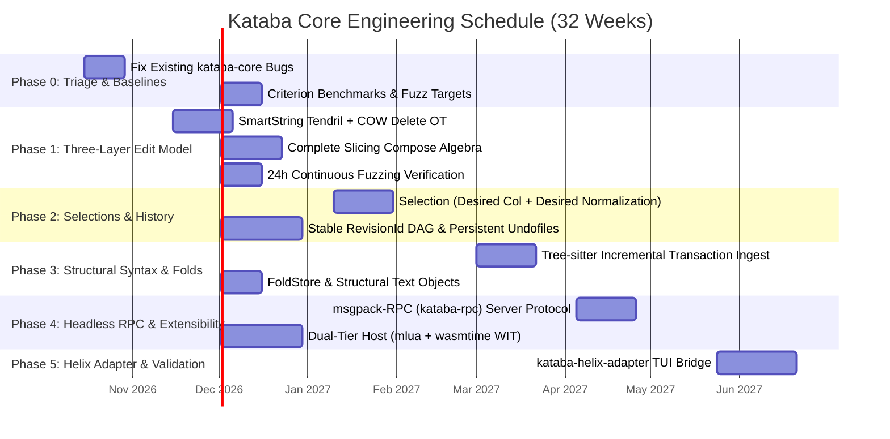

# Kataba Core: Vision, Architecture & Implementation Roadmap

> **"Lead with invariants, not features."**
> 
> *Kataba Core (`kataba-core`) is a pure, embeddable, mathematically verified text editing engine written in safe Rust. It reconciles four decades of editor engineering into a deterministic, fuzz-tested foundation.*

---

## 1. Executive Vision: The Four-Way Synthesis

Modern text editors have historically forced developers to choose between conflicting philosophies:

- **Neovim**: High-throughput, non-blocking actor loop, embeddable headless msgpack-RPC, and persistent undofiles (`.undofile`), but crippled by 300,000 lines of legacy C, procedural mutations (`memline.c`), and an awkward single-cursor core.
- **Helix**: Selection-first multi-cursor algebra, algebraic Operational Transformation (OT), and structural Tree-sitter integration, but crippled by an inflexible walled garden (no plugin engine), ephemeral undo lost on exit, and a monolithic terminal-only binary.
- **Emacs**: Total programmability where the editor is a host, modernized via typed WebAssembly components (WASM/WIT) and Lua scripting.
- **Zed**: Unified multi-buffer editing, zero-copy B-tree ropes, and first-class AI prediction and edit preview staging.

### The Kataba Strategic Wedge
Kataba takes **Helix's mathematical precision** and merges it with **Neovim's hackability and embeddability**, while fixing the architectural flaws of both:

| Capability | Neovim | Helix | Kataba Core |
| :--- | :---: | :---: | :---: |
| **Cursor Model** | ❌ Single-cursor C core (Lua hack) | ✅ Multi-cursor primitive | ✅ **Multi-cursor as the ONLY primitive** |
| **Change Model** | ❌ Procedural line mutations | ✅ Algebraic OT (`ChangeSet`) | ✅ **Three-Layer OT with $O(1)$ COW deletions** |
| **Persistent Undo** | ✅ Persistent `.undofile` | ❌ Ephemeral (lost on exit) | ✅ **Persistent DAG undofiles with stable IDs** |
| **Extensibility** | ✅ In-process LuaJIT | ❌ None (monolithic) | ✅ **Dual-Tier: LuaJIT (`mlua`) + WASM (`wasmtime`)** |
| **Headless Embedding**| ✅ msgpack-RPC server | ❌ Terminal binary only | ✅ **Native msgpack-RPC protocol (`kataba-rpc`)** |
| **AI Foundations** | ❌ Plugin virtual text hacks | ❌ None | ✅ **Core streaming prediction & preview hooks** |
| **Language & Safety** | ❌ 300k lines of C99 | ✅ 25k lines of Rust | ✅ **Pure, audited, `#![forbid(unsafe_code)]` Rust** |

---

## 2. Explicit Scope: What Kataba Core Targets vs. Rejects

`kataba-core` is **not** an editor binary. It does not draw pixels or render terminal cells. It is the **pure engine** crate.

### In-Scope (What `kataba-core` Owns)
1. **Text Representation (`TextBuffer`):** Wraps `ropey::Rope` as a copy-on-write B-tree with zero-copy grapheme cluster streaming and multi-coordinate translations (Char, Byte, Grapheme, UTF-16, Display).
2. **Operational Transformation (`ChangeSet` & `Transaction`):** Three-layer edit pipeline with a complete 9-case slicing compose algebra and pure, document-independent inversion.
3. **Strict Multi-Cursor Selections (`Selection` & `Range`):** Every motion is selection-first. Disjoint, sorted normalization with primary cursor preservation and active-head visual column memory (`desired_col`).
4. **Persistent State Journal (`History`):** Acyclic revision DAG with stable generational `RevisionId(u64)`s, bounded LRU byte-budget eviction, and binary `.undofile` serialization.
5. **Structural Syntax (`LayerStack`):** Consumes sequential atomic `Transaction`s to derive 6-field `tree_sitter::InputEdit`s, evaluating pure data-driven `TextObjectQuery`s.
6. **Editing Primitives as Data:** `RegisterStore` (yank/named/numbered), `MacroRecorder` (replaying deterministic command streams), and active `SnippetSession` tabstops.

### Out-of-Scope (Strict Non-Goals for `kataba-core`)
- 🚫 **No UI, Rendering, or ANSI Escapes:** Belongs strictly in `kataba-term`.
- 🚫 **No `tokio` or Async Runtimes in Core:** Core is 100% synchronous and deterministic. Async loops belong in the application shell.
- 🚫 **No Direct Filesystem or Network I/O:** Core operates on in-memory bytes. File watchers and socket I/O belong in outer service actors.
- 🚫 **No Direct C FFI (`mlua` / `wasmtime`):** Core is `#![forbid(unsafe_code)]`. Language runtimes live in satellite bridge crates (`kataba-lua`, `kataba-wasm`).
- 🚫 **No Multi-Buffer Chimera (`BufferSet`):** Multi-file excerpt coordination lives in the **Workspace / View Layer**.

---

## 3. Core Mathematical Axioms

Every module in `kataba-core` is governed by formal properties verified under `proptest` and `cargo-fuzz`:

### Axiom Set A: Operational Transformation Algebra
- **A1 (Pure Inversion Identity):**
  $$\forall cs, \forall doc \implies \text{apply}(\text{invert}(cs), \text{apply}(cs, doc)) \equiv doc$$
- **A2 (Compositional Equivalence):**
  $$\forall a, b, \forall doc \implies \text{apply}(\text{compose}(a, b), doc) \equiv \text{apply}(b, \text{apply}(a, doc))$$
- **A3 (Inversion Distribution):**
  $$\text{invert}(\text{compose}(a, b)) \equiv \text{compose}(\text{invert}(b), \text{invert}(a))$$
- **A4 (Total Text Preservation):**
  Composing two edits preserves all deleted text segments across cancellations so that $\text{invert}$ remains valid without querying original document states.

### Axiom Set S: Selection Invariants
- **S1 (Idempotence of Normalization):**
  $$\forall s \implies \text{normalize}(\text{normalize}(s)) \equiv \text{normalize}(s)$$
- **S2 (Strictly Disjoint & Sorted):**
  $$\forall i < j \in \text{normalize}(s) \implies s[i].\text{to}() < s[j].\text{from}()$$
- **S3 (Active Head Preservation):**
  Normalization preserves the identity and relative visual offset of the active cursor head across range merges.

### Axiom Set H: History Invariants
- **H1 (Reversible Step):**
  $$\forall h \text{ where } \text{redo}(h) = \text{Some}(h') \implies \text{undo}(h') = \text{Some}(h)$$
- **H2 (Acyclic Revision Graph):**
  The revision graph is a strictly acyclic tree rooted at Revision 0 with bounded memory.

---

## 4. The Three-Tier Concurrency Architecture

```mermaid
graph TD
    subgraph "Tier 1: Pure Core (Synchronous, Deterministic State Machine)"
        State[DocumentState: TextBuffer, ChangeSet, Selection, History]
        StepFunc["apply_command: (DocumentState, Command, LogicalTime) -> (DocumentState, Vec<CoreEvent>)"]
    end

    subgraph "Tier 2: Document & Workspace Actors (Sequential Mailbox, tokio::mpsc)"
        DocActor[DocumentActor: Mailbox Processor]
        Workspace[WorkspaceActor: Multi-Buffer Coordinator]
    end

    subgraph "Tier 3: Snapshot Worker Pool (Parallel Background Tasks)"
        SnapshotType["BufferSnapshot: Explicit Arc<Node> B-Tree wrapper"]
        TSWorker["Tree-sitter Incremental Parser Worker"]
        LSPWorker["LSP Translation & Wire Worker"]
        WASMWorker["WASM Plugin Host (wasmtime + fuel/epoch)"]
        AIWorker["Async Prediction & Agent Preview Worker"]
    end

    DocActor -->|Executes sync| StepFunc
    DocActor -->|Produces O(1)| SnapshotType
    
    SnapshotType -.->|Immutable Snapshot + Version| TSWorker
    SnapshotType -.->|Immutable Snapshot + Version| LSPWorker
    SnapshotType -.->|Immutable Snapshot + Version| WASMWorker
    SnapshotType -.->|Immutable Snapshot + Version| AIWorker

    TSWorker -->|Result + Version N| DocActor
    LSPWorker -->|LspEdit + Version N| DocActor
    WASMWorker -->|PluginCommand + Version N| DocActor
    AIWorker -->|Preview + Version N| DocActor
```

- **Tier 1 (The Pure Core):** Zero async, zero mutexes, zero network/disk I/O. Single-threaded, pure state machine. Fuzzable with `cargo-fuzz` in synchronous isolation.
- **Tier 2 (Document Actors):** Single-threaded actor per buffer with a sequential `tokio::mpsc` mailbox. State transitions execute sequentially.
- **Tier 3 (Snapshot Worker Pool):** Long-running tasks never block Tier 2. `BufferSnapshot` clones the `ropey::Rope` B-tree in **$O(1)$ ($\le 50\text{ns}$)** via root refcount bumps. Background workers query immutable snapshots with a `version: u64`. Stale results are rebased or discarded.

---

## 5. The Three-Layer Edit Taxonomy

```
┌────────────────────────────────────────────────────────┐
│ Layer 1: ChangeSet (Structural Delta)                  │
│ • Retain(usize), Delete(usize), Insert(Tendril)        │
│ • Generated by commands, input loop, and LSP edits     │
│ • Does NOT require reading document bytes to construct │
└───────────────────────────┬────────────────────────────┘
                            │ Committed against TextBuffer
                            ▼
┌────────────────────────────────────────────────────────┐
│ Layer 2: Transaction (Committed Local Edit)            │
│ • ChangeSet + deleted_text: Option<ropey::Rope>        │
│ • Deleted text captured O(1) via Rope COW subtrees     │
│ • Pure inversion: invert(&self) -> Transaction         │
│ • Stored in History for local undo/redo                │
└───────────────────────────┬────────────────────────────┘
                            │ Serialized for IPC / Sync
                            ▼
┌────────────────────────────────────────────────────────┐
│ Layer 3: WireEdit (Network & Serialization Frame)      │
│ • Flat indices + serialized text chunks                │
│ • Used by msgpack-RPC, undofiles, and CRDT/OT sync     │
└────────────────────────────────────────────────────────┘
```

### The Slicing Zipper Compose Algebra (All 9 Cases)
1. **`Retain(n1) ∘ Retain(n2)`:** Emit `Retain(min(n1, n2))`. Deduct from both.
2. **`Retain(n1) ∘ Delete(d2)`:** Emit `Delete(min(n1, d2))`. Deduct from both.
3. **`Retain(n1) ∘ Insert(s2)`:** Emit `Insert(s2)`. Advance $j$. Do not advance $i$.
4. **`Delete(d1) ∘ Retain(n2)`:** Emit `Delete(min(d1, n2))`. Deduct from both.
5. **`Delete(d1) ∘ Delete(d2)`:** Emit `Delete(d1 + d2)`. Advance both.
6. **`Delete(d1) ∘ Insert(s2)`:** Emit `Delete(d1)`, then `Insert(s2)`. Advance both.
7. **`Insert(s1) ∘ Retain(n2)`:**
   - If $|s1| \le n2$: emit `Insert(s1)`, deduct from $n2$.
   - If $|s1| > n2$: emit `Insert(s1[..n2])`, keep remainder in $A$.
8. **`Insert(s1) ∘ Delete(d2)`:**
   - If $|s1| == d2$: completely cancelled (no ops emitted).
   - If $|s1| > d2$: emit `Insert(s1[d2..])` (partial insert remains).
   - If $|s1| < d2$: $s1$ wiped out, remaining delete debt continues in $B$.
9. **`Insert(s1) ∘ Insert(s2)`:** $s2$ is placed immediately *before* $s1$ in the post-$A$ document. Emit `Insert(s2)`, advance $j$, retain $s1$.

---

## 6. Selections, Geometry & Desired Column

### Range vs. Cursor Separation
```rust
#[derive(Debug, Clone, Copy, PartialEq, Eq)]
pub struct Range {
    pub anchor: usize,
    pub head: usize,
}

impl Range {
    #[inline] pub fn from(&self) -> usize { self.anchor.min(self.head) }
    #[inline] pub fn to(&self) -> usize { self.anchor.max(self.head) }
    #[inline] pub fn is_backward(&self) -> bool { self.head < self.anchor }
    #[inline] pub fn swap(&mut self) { std::mem::swap(&mut self.anchor, &mut self.head); }
}

#[derive(Debug, Clone, PartialEq, Eq)]
pub struct Selection {
    pub ranges: smallvec::SmallVec<[Range; 1]>,
    pub primary_index: usize,
    /// Preserved visual display column for the active primary head.
    /// Preserved across vertical motions; reset on horizontal motions.
    pub desired_col: Option<u32>,
}
```

### Position Mapping: Transient vs. Stored
- **Transient (Call-Site):** `changes.map_offset(offset, assoc)` and `map_range(range, assoc)` for live rendering and cursor updates.
- **Stored (`StickyPosition`):** `StickyPosition { offset: usize, assoc: Assoc }` for persistent marks (`'a`–`'z`), jump list entries, and visual savepoints (`gv`).

---

## 7. History Engine: Stable Generational DAG & Persistent Undofiles

### Generational IDs & Reference Safety
Revisions use monotonic 64-bit IDs (`RevisionId(u64)`) that **never shift** during root collapses or LRU leaf pruning:
```rust
#[derive(Debug, Clone, Copy, PartialEq, Eq, Hash)]
pub struct RevisionId(pub u64);

#[derive(Debug, Clone)]
pub struct Revision {
    pub id: RevisionId,
    pub parent: Option<RevisionId>,
    pub children: smallvec::SmallVec<[RevisionId; 2]>,
    pub transaction: Transaction,
    pub lru_generation: u64,
    pub approx_bytes: usize,
}
```
- **Byte Budget & Eviction:** When `allocated_bytes > undo_limit_bytes`, prunes unreferenced leaf revisions with the lowest `lru_generation`.
- **External Guard:** Jump lists and marks query `history.is_alive(id)` before jumping, safely falling back to the nearest live ancestor if a revision was pruned.
- **Persistent Storage:** Written to disk on idle timeout (debounced 2000ms) and flushed on buffer close via atomic `.tmp` swap (`rename(2)`). SHA-256 header checksum detects external edits and safely quarantines corrupted histories.

---

## 8. Multi-Buffer Coordination (Workspace Layer)

Multi-buffer editing (`BufferSet`) is explicitly a **Workspace / View Layer** construct. Individual buffers remain atomic and pure:
- **`real_to_virtual` / `virtual_to_real`:** Bidirectional $O(\log S)$ indexing using binary search over sorted span arrays.
- **Dry-Run Protocol:** Multi-buffer edits run a synchronous dry-run check (`can_apply(&txn)`) across all affected buffers. A single rejection cleanly aborts the entire set.
- **Workspace Undo:** Composite `WorkspaceTransaction` records link per-buffer revisions for unified, atomic cross-buffer undo.

---

## 9. Dual-Tier Extensibility: Shared Canonical WIT

To prevent API drift between scripting and plugins:
- **Canonical WIT Specification (`kataba:core@0.1.0`):** Defines the single source of truth for buffer operations, types, and error variants.
- **Tier A (In-Process LuaJIT via `mlua`):** Binds directly to canonical WIT types. Sub-millisecond startup, zero compilation step, instant user keymaps and text objects.
- **Tier B (WASM Components via `wasmtime`):** Sandboxed guest execution with fuel metering (1M instructions/event) and epoch interruption (20ms timeout) for distributed plugin registries.

---

## 10. Phased Implementation Roadmap



### Concrete Checkpoints
- **Checkpoint 1 (Phase 1 Complete):** `ChangeSet::compose` and `Transaction::invert` survive 24 hours of continuous `cargo-fuzz` execution without invariant violations ($A1$–$A4$).
- **Checkpoint 2 (Phase 2 Complete):** Multi-cursor selections remain sorted and disjoint under 10,000 cursors. Persistent undofiles survive editor reboots with LRU byte pruning.
- **Checkpoint 3 (Phase 4 Complete):** Headless msgpack-RPC server drives buffers over Unix sockets; Lua scripts configure keymaps using the canonical WIT interface.
- **Checkpoint 4 (Phase 5 Complete):** Kataba Core drives Helix's terminal frontend via `kataba-helix-adapter` with 100% keymap parity and persistent undo.
